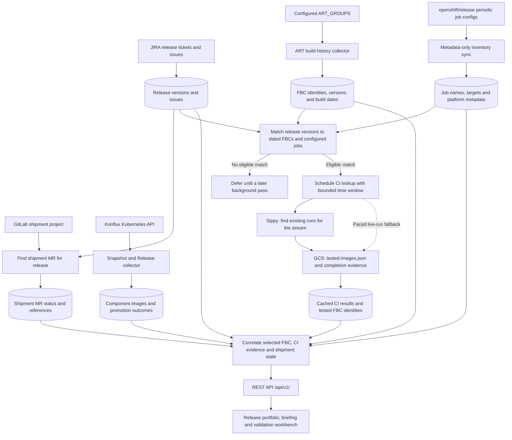

# Architecture

[Back to the project README](../README.md)

The Go backend collects source records in SQLite, then correlates them for the
embedded React dashboard. ART and Konflux ingest independently. JIRA release
tickets drive the shipment MR lookup; Prow configuration discovery stores only
job metadata until a release has a dated FBC to validate.

Database nodes represent tables in the same SQLite database. Catalog-content
rendering, image resolution, CVE scans and publication checks enrich these records;
the diagram focuses on the release and CI ingestion workflow.

- CI lookup queries existing executions; it never launches Prow jobs.
- The search window uses ART build start time minus a configurable lookback,
  bounded by retention. The timestamp narrows the search; the artifact confirms identity.
- A passing run with a different FBC digest remains visible with a warning and
  does not pass the selected-FBC readiness gate.
- Current releases take priority. Historical-only streams run afterward with
  separate budgets. Source failures, stale data and idle collectors are tracked independently.

## Implementation boundaries

- `cmd/release-readiness/`: configuration, database startup, collector lifecycle,
  and HTTP server startup.
- `internal/`: independent source clients, background workers, persistence, and
  release correlation. `internal/server/` exposes the API and embedded SPA.
- `internal/db/`: SQLite migrations and query wrappers; `internal/db/sqlc/`
  contains generated query code.
- `web/`: React and PatternFly UI; the build is embedded into the Go binary.
- `deploy/`: the Containerfile and OpenShift Kustomize deployment.
- `.tekton/`: Konflux pipelines that build this application, separate from the
  runtime collector that reads product builds from Konflux.

The HTTP server and collectors run in one process. The supported deployment uses
one replica and Recreate updates for its persistent SQLite volume. Pages read
stored data; CI discovery is scheduled by background workers. Some enrichment
endpoints, such as FBC tag lookup, perform bounded and cached source reads.

## Persistence and upgrades

`db.Open` applies ordered, transactional migrations and records their version in
`PRAGMA user_version`. Existing supported databases migrate in place; a database
newer than the binary is rejected. Back up the database/PVC before upgrading.
Do not delete the database as a routine upgrade step. Rollbacks may require
restoring a matching backup when the older binary cannot read the newer schema.

See [how readiness works](how-it-works.md), [source synchronization](syncing.md),
and [CLI configuration](cli-reference.md) for the operational details.
